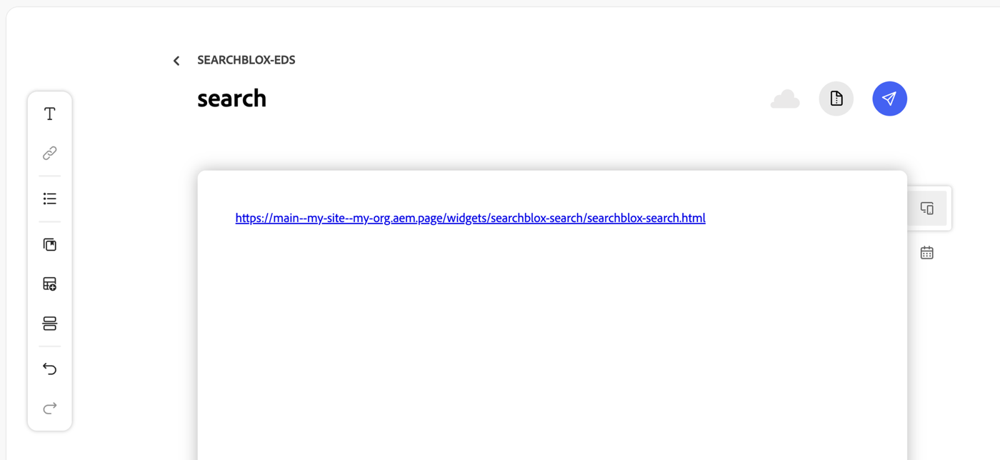
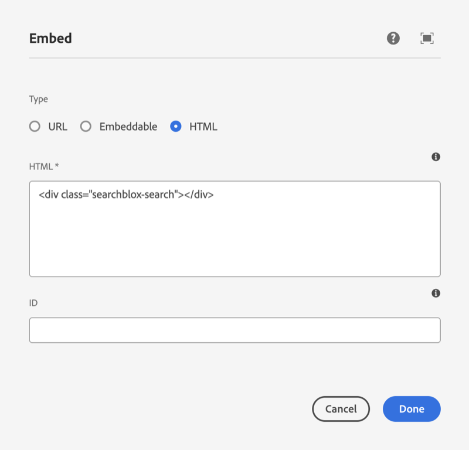

# SearchBlox for Adobe Experience Manager and Edge Delivery Services

**Works with:** Edge Delivery Services (aem.page / aem.live sites) · AEM as a Cloud Service · AEM 6.x

A search widget for Adobe Experience Manager (AEM) sites, both Edge Delivery Services (EDS) and classic AEM, powered by the [SearchBlox Search API](https://developer.searchblox.com/reference/new-search-api-restv2apisearchquery). It brings the SearchBlox search plugin's features to a page as one embeddable widget: hybrid search, suggestions, facets, AI overview, AI Mode, a chatbot and more. Plain JavaScript and CSS, no build step and no dependencies.

**Contents**

1. [How it works](#how-it-works)
2. [SearchBlox setup](#searchblox-setup)
3. [EDS](#eds)
4. [AEM](#aem)
5. [Options](#options)
6. [Updating](#updating)
7. [Working on the widget](#working-on-the-widget)
8. [Third-party notices](#third-party-notices)

## How it works

1. **SearchBlox** holds the content and answers searches. You allow your site to call it.
2. **Your site** gets the widget's files and one settings file: the SearchBlox address, which collections to search and which features to turn on.
3. **Authors** place the widget on a page: a link on its own line in an EDS document, or an Embed component on an AEM page.

## SearchBlox setup

Once, in SearchBlox: make the collections you want to search [public](https://developer.searchblox.com/docs/collection-dashboard), note their IDs and names from the collections list, and [enable CORS](https://developer.searchblox.com/docs/enable-cors) for every address the widget runs on: the site's domain, its `aem.page` and `aem.live` addresses on EDS, and the publish and author addresses on AEM (the widget also runs in the page editor). Without CORS, the browser blocks every search.

## EDS

For sites on Edge Delivery Services (`aem.page` / `aem.live`), made from Adobe's [aem-boilerplate](https://github.com/adobe/aem-boilerplate). New to Edge Delivery Services? Adobe's [developer tutorial](https://www.aem.live/developer/tutorial) creates a site from the boilerplate, with Code Sync and Document Authoring, in about 15 minutes.

### 1. Add the files to the site's repo

Copy this repo's `widgets/searchblox-search/` folder into the site's repo, so it ends up here:

```
<site repo>/
├── blocks/
├── scripts/
└── widgets/
    └── searchblox-search/
        ├── searchblox-core.js
        ├── searchblox-search.css
        ├── searchblox-search.html
        ├── searchblox-search.js
        └── searchblox-config.json   ← you create this (step 2)
```

### 2. Add the settings file

Create `widgets/searchblox-search/searchblox-config.json` with your SearchBlox address and collection IDs, then commit and push it to the site's repo. EDS publishes it to the site within a minute or two.

```json
{
  "domain": "https://search.example.com",
  "collections": "1"
}
```

Add more [options](#options) here to turn on features, for example `"facets": "contenttype,lastmodified:Date"` or `"chatbot": "my-chatbot"`. Every search widget on the site uses this file. If it isn't valid JSON, the browser console says so.

### 3. Add a search page

Authors do this in the site's documents.

**In Document Authoring (da.live):**

1. Go to `https://da.live/#/<owner>/<repo>` (the owner and repo names from the site's `aem.page` address).
2. Create a document named `search` (**New** → **Document**).
3. On a line by itself, paste:
   ```
   https://main--<repo>--<owner>.aem.page/widgets/searchblox-search/searchblox-search.html
   ```
   It has to be a link with nothing else in its paragraph; pasting the address makes it a link.
4. Click the paper-plane button at the top right, then **Preview**. The page opens at `https://main--<repo>--<owner>.aem.page/search` with the search widget in place of the link.
5. When it looks right, click **Publish** in the same menu. The page goes live at `https://main--<repo>--<owner>.aem.live/search`.



**In Google Docs or Word (SharePoint):** create a document named `search` in the site's content folder, paste the same link on its own line, then click **Preview** and **Publish** in the [AEM Sidekick](https://chromewebstore.google.com/detail/aem-sidekick/igkmdomcgoebiipaifhmpfjhbjccggml) browser extension.

To change an option on one page only, add it to that page's link: `…/searchblox-search.html?pageSize=20`. It overrides the settings file.

### Older EDS sites

Widget links need an aem-boilerplate version from June 2026 or later. If the link stays a plain link on preview, update the site's `scripts/scripts.js` and `blocks/widget/` from the [current boilerplate](https://github.com/adobe/aem-boilerplate). (Sites that prefer EDS blocks can use `blocks/searchblox-search/` instead: a block named "SearchBlox Search", with optional rows overriding settings.)

## AEM

For AEM as a Cloud Service and AEM 6.x sites built with Core Components. New to AEM projects? Start from Adobe's [AEM project archetype](https://github.com/adobe/aem-project-archetype), which these steps assume. A developer does steps 1 to 4 once; authors do step 5.

### 1. Add the client library to the project

Copy this repo's `aem-classic/clientlib-searchblox/` folder, including its hidden `.content.xml` file, into the project's `ui.apps` module, next to the other client libraries:

```
ui.apps/src/main/content/jcr_root/apps/<site>/clientlibs/
├── clientlib-base/
├── clientlib-site/
└── clientlib-searchblox/          ← copy here
    ├── .content.xml               (category: searchblox.search)
    ├── css.txt
    ├── js.txt
    ├── css/searchblox-search.css
    └── js/
        ├── searchblox-config.js   ← your settings (step 2)
        └── searchblox-search.js
```

### 2. Set your settings

Edit `clientlib-searchblox/js/searchblox-config.js`:

```js
window.SearchBloxConfig = {
  domain: 'https://search.example.com',
  collections: '1',
};
```

Add more [options](#options) here to turn on features, for example `facets: 'contenttype,lastmodified:Date'` or `chatbot: 'my-chatbot'`.

### 3. Load it on every page

AEM only sends a page the client libraries its template includes. Every page already loads `clientlib-base`, so embedding the widget there loads it everywhere. (Or add `searchblox.search` to a template's page policy under **Client-side libraries** to load it only on pages from that template.)

Open `ui.apps/src/main/content/jcr_root/apps/<site>/clientlibs/clientlib-base/.content.xml` and add `searchblox.search` at the end of its `embed` list:

```xml
embed="[core.wcm.components.accordion.v1,core.wcm.components.tabs.v1,…,searchblox.search]"
```

### 4. Deploy

- **AEM as a Cloud Service:** commit, push to the Cloud Manager git repository, and run the deployment pipeline in Cloud Manager.
- **Local AEM SDK or AEM 6.x:** `mvn clean install -PautoInstallSinglePackage` from the project root.

### 5. Add a search page

1. In AEM, go to **Sites**, open your site, select the parent page (for example the language root), then **Create** → **Page**. Pick a template, set the title to `Search` and the name to `search`, and click **Create**.
2. Open the page in the editor. In a layout container, click **Drag components here**, then the **+** (Insert component) and choose **Embed**.
   If Embed isn't in the list, allow it once in the template: **Tools** → **General** → **Templates** → your template → the layout container's **Policy** → **Allowed Components** → tick **Embed**.
3. Select the Embed component and click the wrench (**Configure**). Set **Type** to **HTML**, paste the following, and click **Done**:
   ```html
   <div class="searchblox-search"></div>
   ```
   
4. Switch to **Preview** to try it, then publish the page (**Page Information** → **Publish Page**).

To change an option for one widget only, add it to its `<div>` as a dashed `data-` attribute, for example `data-page-size="20"`. It overrides `searchblox-config.js`. If it has no effect, check the published page's source: AEM's HTML filter may have removed the attribute.

## Options

Options go in the settings file: `searchblox-config.json` on EDS, `searchblox-config.js` on AEM. Write the names as shown (camelCase); in an AEM `data-` attribute they're dashed (`pageSize` → `data-page-size`). Lists are comma-separated, and on/off options take `true` or `false`. **Needs:** says what has to exist in SearchBlox first.

Always on, with no option: result cards with page numbers, a no-results page, selected-filter chips with **Clear all**, and **More like this** on web-page results. An empty search lists everything.

**Search**

| Option | Default | Description |
| --- | --- | --- |
| `domain` | required | SearchBlox URL, e.g. `https://search.example.com`. **Needs:** the site's address in `cors.allowOrigin` |
| `collections` | all public | Collection IDs to search. **Needs:** Public collections |
| `vectorWeight` | `0.2` | Share of meaning-based matching, `0`–`1`. `0` is keyword search, which adds a sort menu |
| `vectorThreshold` | `0.6` | Minimum similarity for hybrid results, `0`–`1` |
| `sort` | `relevance` | Initial order: `relevance` (the console's manual ranking first) or `date` |
| `pageSize` | `10` | Results per page (at most 50 in hybrid search) |
| `loadMore` | `false` | A **Load more** button instead of page numbers |
| `resultsPage` | none | Makes the widget a search box only, which goes to this page with `?q=`. Use it for a search box in the site header (EDS `nav` document, or the AEM header experience fragment) |
| `placeholder` | `Enter a search term...` | Search box placeholder |
| `topQueries` | `true` | Popular searches ("Or search for:") when nothing matches |

**Suggestions and voice**

| Option | Default | Description |
| --- | --- | --- |
| `autosuggest` | `true` | Suggestions while typing, from 3 characters |
| `suggestLimit` | `6` | Number of suggestions |
| `smartSuggest` | none | Collection name whose SmartSuggest index supplies the suggestions; falls back to autocomplete. **Needs:** a SmartSuggest index on that collection |
| `trending` | none | Collection name whose document titles are listed as trending searches, when the empty search box is focused. **Needs:** that collection |
| `voiceSearch` | `false` | Microphone button in the search box. **Needs:** speech-to-text in SearchBlox, for browsers without their own recognition (Firefox, Edge, Brave) |

**Results and facets**

| Option | Default | Description |
| --- | --- | --- |
| `facets` | none | Facet fields, each with an optional label: `contenttype,topics,keywords,colname:Section,lastmodified:Date`. Without a label: Content Type, Topics, Keywords, Collection and Date |
| `checkboxFacets` | `topics,keywords` | Facets that allow several values; the others allow one |
| `dateFacets` | `lastmodified` | Facet fields shown as dates (presets and a custom range) |
| `featured` | `true` | Featured results on page 1. **Needs:** featured results set up in the console |
| `urlDisplay` | `true` | Each result's URL under its title |
| `newTab` | `false` | Open results in a new tab |
| `smartFaqs` | `true` | SmartFAQs above the results and in the suggestions. **Needs:** SmartFAQs generated for the collections |
| `llmFields` | `off` | LLM-generated fields: `off`, `replace` (generated text, with topic chips) or `both` (the page's own, with a box of the generated). **Needs:** LLM enrichment of the collection |

**AI**

| Option | Default | Description |
| --- | --- | --- |
| `aiOverview` | none | Collection names to answer from: an AI answer with key points, sources and related questions above the results. **Needs:** an LLM on those collections |
| `recommendations` | `false` | AI recommendations after 3 opened results. **Needs:** an LLM |
| `assist` | `false` | SearchAI Assist button on each result: summarize, compare or ask about up to 4 picked results. **Needs:** an LLM |
| `aiMode` | none | Chatbot name for AI Mode: a conversation in place of the results, with references and follow-up questions. On a search box only, the button opens AI Mode on the results page. **Needs:** that chatbot |
| `chatbot` | none | Chatbot name for the chat button at the bottom right. Its console settings (greeting, labels, sensitive-data and profanity masking) apply. **Needs:** that chatbot |
| `chatSuggestions` | `false` | Suggest SmartFAQ questions in the chat while typing. **Needs:** SmartFAQs |
| `chatReferences` | `false` | Under each chat answer, the top 2 search results for the question |
| `settings` | `false` | Search Settings and Plugin Settings menus (for demos; not for visitors) |

**Page, look and analytics**

| Option | Default | Description |
| --- | --- | --- |
| `syncUrl` | `true` | Keep the query, page, filters and sort in the page address, and the query in the page title |
| `queryParam` | `q` | Address parameter for the query |
| `analytics` | `true` | Send clicks to SearchBlox analytics, as the plugin does. Set `false` if consent is needed first |
| `accent` | SearchBlox purple | Brand color, e.g. `#e11d48` |
| `scheme` | `auto` | `light` or `dark`; `auto` detects the page background |

The widget inherits the page's font and text color. To restyle it, set CSS variables on `.searchblox-search`: `--sb-accent`, `--sb-accent-contrast`, `--sb-radius`, `--sb-font`, `--sb-surface`.

## Updating

To move a site to a newer version of the widget, copy the new files over the old ones and keep the site's settings file:

- **EDS:** the four files of `widgets/searchblox-search/` (not `searchblox-config.json`). Push; it's live within a minute or two.
- **AEM:** `css/searchblox-search.css` and `js/searchblox-search.js` of the client library (not `js/searchblox-config.js`). Deploy as in step 4.

## Working on the widget

```bash
node scripts/build-aem.mjs                            # regenerate the AEM client library after changing widgets/
node test/smoke.mjs https://search.example.com 1      # check the API calls against a live server
node demo/serve.mjs https://search.example.com        # local demo at http://localhost:8787
```

The smoke test also checks SmartSuggest, the AI overview, the chatbot and SmartFAQs when you name them: `--smartsuggest=my-collection --ai-overview=my-collection --chatbot=my-chatbot --faq-collections=1` (see the top of `test/smoke.mjs`).

The demo shows a header search box and a results page with every feature on. Options for your server (collection IDs and names, chatbot) go in `demo/demo.local.json`, which git ignores; copy `demo/demo.local.example.json` to start. Its top bar has switches for a dark page and for the AI features (on wherever configured); any option can also be set in the demo page's URL, e.g. `?vectorWeight=0`.

## Third-party notices

- Icons from [Tabler Icons](https://tabler.io/icons) (MIT License, © Paweł Kuna), plus the "AI chip" icon used by the SearchBlox search plugin (from SVGRepo).
- The chat's default profanity word list is from [badwords-list](https://github.com/MauriceButler/badwords) 2.0.1 (MIT License, © 2013 Maurice Butler).

---

Adobe and Adobe Experience Manager are either registered trademarks or trademarks of Adobe in the United States and/or other countries. This project is not affiliated with or endorsed by Adobe.
